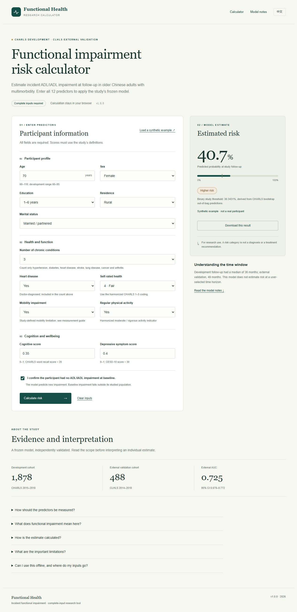

# Functional impairment risk calculator

A browser-based calculator for incident ADL/IADL functional impairment in older Chinese adults with multimorbidity. It uses the study's frozen **20-model XGBoost ensemble**, developed in CHARLS and independently validated in CLHLS.

**All 12 predictors must be observed and entered.** This edition calculates the complete-input prediction without distributing the MICE donor kernel. It does not impute unknown values, retrain the model, or provide individual SHAP explanations.

## Use the calculator

1. Download the repository as a ZIP and extract the entire folder, or clone it.
2. Open **`index.html`** in a browser. Keep `assets/` and `models/` alongside it.
3. Enter all predictors, confirm no baseline ADL/IADL impairment, and select **Calculate risk**.

No Python, package installation or internet connection is required for prediction. Select **中文** for the Chinese interface. **Load a synthetic example** demonstrates the tool; it never loads a real participant.



The scripts are designed for direct file opening. Automated browser QA verified the HTTP-served page; the automation browser's URL policy prohibits `file://`, so direct double-click opening was not tested through that browser.

If your browser or institutional policy prevents opening local scripts, serve the folder using Python 3:

```bash
python -m http.server 8000 --bind 127.0.0.1
```

Then open `http://127.0.0.1:8000`. Windows users can use `start-local.bat` after installing Python. The script only serves static files locally; no prediction backend is needed.

## 中文使用说明

下载 ZIP 并解压整个文件夹，或克隆仓库，然后用浏览器打开 `index.html`。请保留同目录中的 `assets/` 和 `models/`，点击 **中文** 切换界面。完整填写 12 个预测变量，确认基线时无 ADL/IADL 功能受损，再计算风险。计算无需联网、安装软件包或运行预测服务器。

如果浏览器限制本地脚本，可以在仓库目录运行上述 Python 本地静态服务器命令，再打开 `http://127.0.0.1:8000`；Windows 用户也可以运行 `start-local.bat`。变量测量及编码见 [变量字典](docs/predictor-dictionary.md)，适用范围与局限见 [模型说明](docs/model-card.md)。

## Scope

The model concerns new impairment at the study follow-up among older adults with at least two of seven harmonized chronic conditions and no ADL/IADL impairment at baseline. Development participants were aged ≥60; external-validation participants were aged ≥65.

| Evidence | CHARLS development / internal validation | CLHLS independent external validation |
|---|---|---|
| Participants / events | 1,878 / 561 | 488 / 148 |
| Follow-up median | 36 months | 49 months |
| AUC | Optimism-corrected 0.700 (95% CI 0.678–0.721) | 0.725 (95% CI 0.678–0.772) |
| Brier score | Optimism-corrected 0.189 | 0.186 |
| Calibration slope | Pooled out-of-bag 1.084 | 1.414 |
| Calibration-in-the-large | Pooled out-of-bag 0.019 | 0.006 |

These are study validation metrics, not performance estimates from a separate complete-case-only clinical cohort. The model does not predict at arbitrary selected time points, and clinical impact of using its results has not been established.

The two-category risk threshold is **0.3034314632454784**, frozen from CHARLS pooled bootstrap out-of-bag predictions using the Youden index. There is no intermediate-risk category. Classification uses the unrounded computed probability; the webpage rounds the percentage for display.

## Model fidelity and validation

All 20 classifiers, their corresponding StandardScaler parameters, the predictor order and the threshold were exported from the frozen study model; none were refitted. For complete inputs, the original MICE path left all values unchanged. The native Python reference is compared with browser-engine predictions on **3,587 independently generated synthetic cases**, including valid continuous inputs around tree splits.

The maximum probability difference was **3.4273 × 10⁻⁸**, with **0 risk-category mismatches** on those cases. Acceptance tolerance is 10⁻⁶. This is numerical agreement, not a guarantee of bitwise identity for every possible input. See [validation details](docs/validation.md) and the machine-readable reports in `tests/`.

The exported tree parameters and standardized inference logic are intentionally separated from training and imputation data. The original model SHA-256 is recorded in the bundle for provenance; the original pickle is not included.

## Repository contents

```text
index.html                 English / Chinese calculator
assets/                    Browser UI, validation, float32-aware inference, CSS
models/ensemble.json        Canonical inference parameters (20 models)
models/model-data.js        Same parameters, bundled for direct file opening
models/metadata.json        Scope, version and provenance
docs/                      Model card, predictor dictionary and validation
examples/                  Synthetic inputs only
tests/                     Synthetic Python reference outputs and Node verification
scripts/                   Maintainer export and package-audit scripts
start-local.bat            Optional local static serving on Windows
SHA256SUMS.txt              Package file hashes
```

## Optional verification

Node.js is needed only to run the checks, not to use the calculator:

```bash
node tests/verify-model.cjs
node scripts/audit-package.cjs
```

Model export is a maintainer operation requiring the authorized source artefact and its Python environment. `scripts/export_frozen_model.py` only emits an explicitly allowed inference schema and synthetic test records. It is not part of reader setup. See `scripts/requirements-export.txt`.

## Privacy and interpretation

The prediction code contains no remote prediction calls, tracking scripts, external fonts or persistent browser storage. Inputs remain in page memory unless the user downloads a result. Exported model parameters contain no explicit PMM donor rows or survey participant identifiers; this is not a claim that any learned model has zero disclosure risk.

Missing measurements must not be guessed or substituted with zero to obtain a prediction. See [the predictor dictionary](docs/predictor-dictionary.md) for the correct scales and survey-specific definitions. This tool is for research reference and does not replace professional assessment.

